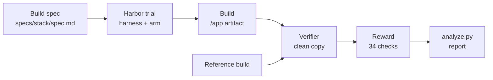
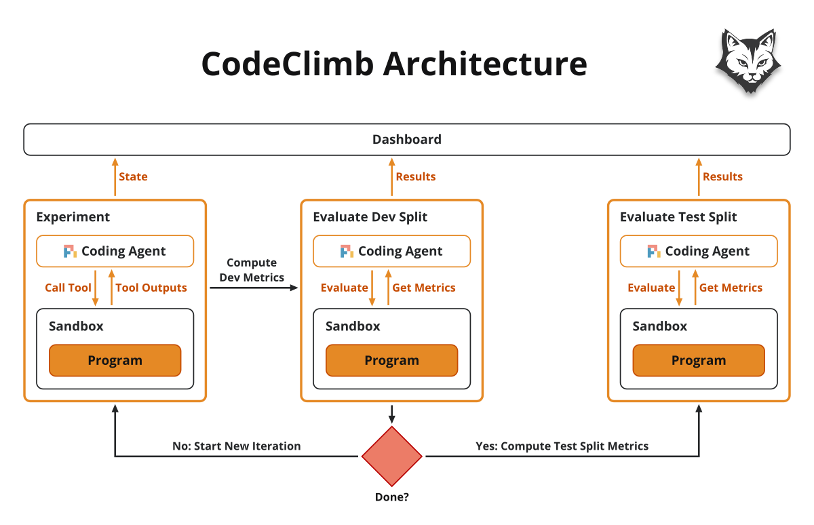
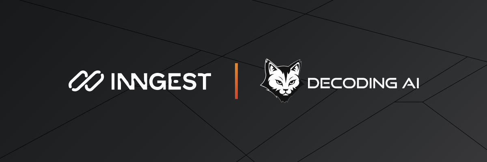

<div align="center">
  <h1>CodeClimb benchmark</h1>
  <h3>Coding-agent benchmark: measure how well a harness builds a long-running agent from a build spec</h3>
  <p><a href="#quickstart">Quickstart</a> · <a href="#guides">Guides</a> · <a href="#see-it-in-action">See it in action</a> · <a href="#learn-more">Learn more</a> · <a href="#questions-and-troubleshooting">Questions</a></p>
  <h3>Sponsored by&nbsp;
    <a href="https://inngest.link/dai-gh"><picture>
      <source media="(prefers-color-scheme: dark)" srcset="assets/sponsors/inngest-dark.svg">
      
    </picture></a>
  </h3>
</div>

<p align="center">
  <a href="LICENSE"></a>
  
  <a href="https://harborframework.com/docs"></a>
</p>

A coding agent says "all seven nights pass". You can't tell whether that is true, or whether the skills, MCP servers and docs you gave it changed anything.

This branch is a [Harbor](https://harborframework.com/docs) benchmark. A harness (Claude Code on Opus 5.5) gets the build spec of [CodeClimb](https://github.com/itsdecodingai/codeclimb/tree/main) and builds it with zero human input, on two stacks: [Inngest](https://inngest.link/dai-gh) and LangChain. It runs 4 arms of starting context per stack, a build-ticket-by-build-ticket workflow, and 10 maintenance tasks per stack on the reference builds.

The harness never grades itself. A verifier reruns every check on a clean copy of the build, in a separate container the harness can't reach. No trial starts until both reference builds reach reward 1.0 under that verifier, and GitHub is blocked so the harness can't read the answer.

## How it works



- **Build spec** — `specs/<stack>/spec.md` states what to build and `e2e.md` the done signal: seven mock nights. Both stacks get the same scenarios, configs and checks.
- **Trial** — Harbor runs the harness once in a container with its own Docker daemon (a `docker:27-dind` sidecar) and the open web, GitHub excepted.
- **Arm** — the extra context a trial starts with: `bare`, `skills`, `mcp-docs` or `full`, set in `job-configs/<stack>-<arm>.yaml`. The task never changes.
- **Verifier** — `verifier/run.py` runs 34 checks on a clean copy; reward = checks passed / 34. 40 hidden tests and 17 to 18 real-model tests are reported beside it.
- **Analysis** — `analyze.py` turns the job folders into `trials.jsonl` and the report: reward per cell, arm effects, the stack comparison, cost and code metrics.

Each trial builds this loop from its build spec:



## 📬 Learn to Build Long-Running Agents

> Join 45k+ engineers reading [the Decoding AI Magazine](https://www.decodingai.com/) and watching [the Decoding AI YouTube channel](https://www.youtube.com/@itsdecodingai) to learn to build durable, secure long-running agents.

<a href="https://www.decodingai.com/" target="_blank">
  
</a>

## Quickstart

**Needs:** Docker running · uv · Python 3 · no keys for the free checks · $0 ([cost by path](guides/01_setup.md#cost)) · 6 CPUs and 6 GB of memory for a trial, no GPU

```bash
git clone -b benchmark https://github.com/itsdecodingai/codeclimb.git codeclimb-benchmark && cd codeclimb-benchmark
uv tool install harbor==0.25.0
git fetch origin main langchain 'refs/heads/benchmark-maint-*:refs/heads/benchmark-maint-*'
DRY=1 job-configs/run-all.sh 3                                     # assemble every task, check all 30 jobs
CODECLIMB_VERIFIER_FAMILIES=basic harbor run -c job-configs/inngest-nop.yaml -y # the floor: no harness
```

In about 30 seconds the dry run prints `ok <job>, 3 attempts` for each of the 30 jobs. The last command grades the given inputs with no harness: reward 0.029 (1 of 34 checks, `install`) in about 2 minutes once the task image is built (measured 2026-11-13), written to `jobs/inngest-nop/<trial>/verifier/reward.json`.

### Set up with your coding agent

```txt
Clone the benchmark branch of https://github.com/itsdecodingai/codeclimb, follow guides/ from
01_setup.md onward (00_troubleshooting.md on any error), and set it up until
DRY=1 job-configs/run-all.sh 3 prints ok for all 30 jobs and the unit tests of
guides/02_running.md#unit-tests pass. Run only the $0 commands. Ask me for
CLAUDE_CODE_OAUTH_TOKEN, LANGSMITH_API_KEY and any other key before a step that needs one.
```

## Guides

| Guide | Read it when |
|---|---|
| [01_setup.md](guides/01_setup.md) | You install Harbor, fetch the reference builds, fill `.env`, or want the cost of each run path |
| [02_running.md](guides/02_running.md) | You run the free checks, grade a reference build, run a probe, one job, a maintenance task or the full run, continue a stopped run, regrade, or produce the report |
| [03_how_it_works.md](guides/03_how_it_works.md) | You need what a trial does, the arms and workflows, the verifier's check families, the files a run writes, the code layout, or Security: what runs where and what leaves the machine |
| [00_troubleshooting.md](guides/00_troubleshooting.md) | A script refuses to start, a reference grade fails, a run stops on a usage limit, or a reward looks wrong |

The contract behind all of it is [docs/codeclimb-eval-spec.md](docs/codeclimb-eval-spec.md); the vocabulary is [GLOSSARY.md](GLOSSARY.md); decisions that are hard to reverse are in [docs/adr/](docs/adr/).

## Who is this for

| Audience | What you get |
|---|---|
| Engineers choosing the context for a coding agent (skills, MCP servers, docs) | A 2 × 2 of arms per stack with reward, cost and time per trial, so you can see whether a lever pays for itself |
| Engineers building their own agent benchmark | A working Harbor setup: a verifier out of the harness's reach, reference gates, a leak scan, usage-limit stops and a regrade rule |

## See it in action

**The full run of 2026-11-20 to 2026-11-24.** 90 trials of Claude Code 2.1.322 on Opus 5.5 at medium effort: 5 build cells and 10 maintenance tasks per stack, 3 trials each, started with one command.

```bash
./start-full-run.sh
```

Nearly every build reaches reward 1.0, so the reward does not separate the cells; the hidden and real tests, the cost and the agent time do. One-shot rows are the mean of the 4 arms:

| Stack | Workflow | Trials at reward 1.0 | Hidden and real tests passed | Mean $ per trial | Agent time, min |
|---|---|---|---|---|---|
| [Inngest](https://inngest.link/dai-gh) | one-shot | 12 / 12 | 93% | 12.38 | 53 |
| [Inngest](https://inngest.link/dai-gh) | pocock | 3 / 3 | 87% | 30.92 | 113 |
| LangChain | one-shot | 11 / 12 | 91% | 14.04 | 77 |
| LangChain | pocock | 3 / 3 | 74% | 29.23 | 110 |

The pocock gap is in the real tests only (hidden: 97% and 92%), and 4 of the 6 pocock trials keep real-test grades from the GitHub Copilot login, while every one-shot trial was graded on the Claude API. Read it as unconfirmed, not as a workflow effect.

No arm effect is detectable at 3 trials per cell. The maintenance tasks resolve 27 of 30 trials on [Inngest](https://inngest.link/dai-gh) and 30 of 30 on LangChain, at a mean of $0.85 per trial. Every table, the code metrics and the trials kept out: [docs/results/metrics.md](docs/results/metrics.md).

The run above took 5 days, stopped and continued three times, and its real tier started on a GitHub Copilot login; `start-full-run.sh` now puts the real tier on the Claude API. Every departure from one clean run is in [docs/results/reproduce.md](docs/results/reproduce.md).

### Run it with your coding agent

```txt
In the benchmark branch of https://github.com/itsdecodingai/codeclimb (set up per
guides/01_setup.md if it isn't yet), follow guides/02_running.md#full-run and
#continue-a-stopped-run to run the benchmark with ./start-full-run.sh, until it prints
"all done; analyze with", then run that analyze.py command per #analysis. Use
00_troubleshooting.md on any error. Before starting, ask me for the keys of
01_setup.md#environment-variables and my go-ahead for about $560 of subscription usage.
```

## Learn more

| # | Article | Video |
|---|---|---|
| 1 | [How to Build a Durable and Secure Long-Running Agent](https://www.decodingai.com/p/build-durable-secure-long-running-agents) | — |

## Sponsors

<p align="center"><i>Thanks again to <a href="https://inngest.link/dai-gh"><b>Inngest</b></a> for sponsoring this project and keeping it free!</i></p>

<p align="center">
  <a href="https://inngest.link/dai-gh"></a>
</p>

<p align="center"><a href="https://inngest.link/dai-gh">Try Inngest for free here</a> (free plan with 50k executions/month, or self-host it, since it's open-source)</p>

<h3 align="center">Build AI agents and workflows that survive crashes, retries, and long waits:</h3>

<p align="center">
  <a href="https://inngest.link/dai-gh"></a>
</p>

## Questions and troubleshooting

Open a [GitHub issue](https://github.com/itsdecodingai/codeclimb/issues) for questions and bugs. Known failures and their fixes are in [00_troubleshooting.md](guides/00_troubleshooting.md).

## 📬 Learn to Build Long-Running Agents

> Join 45k+ engineers reading [the Decoding AI Magazine](https://www.decodingai.com/) and watching [the Decoding AI YouTube channel](https://www.youtube.com/@itsdecodingai) to learn to build durable, secure long-running agents.

<a href="https://www.decodingai.com/" target="_blank">
  
</a>

## Star history

<a href="https://www.star-history.com/?type=date&repos=itsdecodingai%2Fcodeclimb">
 <picture>
   <source media="(prefers-color-scheme: dark)" srcset="https://api.star-history.com/chart?repos=itsdecodingai/codeclimb&type=date&theme=dark&legend=top-left" />
   <source media="(prefers-color-scheme: light)" srcset="https://api.star-history.com/chart?repos=itsdecodingai/codeclimb&type=date&legend=top-left" />
   
 </picture>
</a>

## License

[Apache License 2.0](LICENSE)
