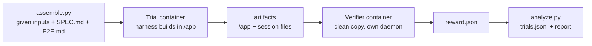

# How it works

After this guide you know what one trial does, what an arm changes, how the verifier turns a build into a reward, which files a run writes and where the code for each part lives.

This is a map. The contract is [docs/codeclimb-eval-spec.md](../docs/codeclimb-eval-spec.md): each section below names the benchmark spec section that holds the detail and the measurements. Words: [GLOSSARY.md](../GLOSSARY.md).

## One trial

A trial is one harness doing one task once, with no human input. Harbor runs it in four steps:



1. **Assemble.** `assemble.py <stack>` builds the task from files on this branch only: the given inputs (`scenarios/`, `configs/`, `docker/`, `specs/<stack>/given/`), the build spec as `/app/SPEC.md` and the done signal as `/app/E2E.md`.
2. **Build.** The harness gets a 15-line instruction: build the app `SPEC.md` specifies until every check in `E2E.md` passes. It works in `/app`, a git repository with one commit, with a Docker daemon of its own and the open web, GitHub excepted.
3. **Collect.** Harbor copies `/app` and the harness's session files out as artifacts.
4. **Grade.** A separate verifier container receives the artifacts, runs `npm ci --ignore-scripts`, rebuilds the images, starts the services and reruns the checks. Results the harness left behind count for nothing.

Benchmark spec sections: Task, Trial environment, Verifier.

## The two stacks

Both tasks ask for the same application, CodeClimb, from two build specs: `specs/inngest/spec.md` builds it on [Inngest](https://inngest.link/dai-gh) (a dev server and one worker), `specs/langchain/spec.md` on LangGraph JS with a self-hosted Agent Server. Both run locally with Docker sandboxes, the same scenarios, the same night configs and the same checks, so a claim across stacks is made only on checks both share.

On Inngest the dev server already runs when the harness starts, because Claude Code connects to MCP servers once, at start ([Inngest local development](https://www.inngest.com/docs/local-development?utm_medium=repo&utm_source=github&utm_campaign=creator-growth-Q326&utm_content=dai)). On LangChain the Agent Server is part of the build, so nothing is pre-started.

Each stack has a reference build, made outside the benchmark and known to work: Inngest `5a81c07` on `main`, LangChain `3612892` on `langchain`. No reference build source is on this branch ([docs/adr/0002](../docs/adr/0002-self-contained-branch-with-vendored-inputs.md)).

Benchmark spec sections: Stack comparison, Reference builds.

## Arms and workflows

An arm is the extra context a harness starts with. It is job config, never a task edit: the four arms of a stack run the same task.

| Arm | Skills | MCP + docs | Inngest | LangChain |
|---|---|---|---|---|
| `bare` | no | no | nothing extra | nothing extra |
| `skills` | yes | no | the 14 skills of the `inngest` plugin | the 28 skills of `langchain-skills` and `langsmith-skills` |
| `mcp-docs` | no | yes | the `inngest-dev` MCP server and a docs block | the `langsmith` and `langchain-docs` MCP servers and a docs block |
| `full` | yes | yes | both | both |

The skills are vendored whole at a pinned commit in `context/<stack>/skills/` (`SOURCE.md` beside them names repo, commit and tree hash). The 2 × 2 gives two effects per stack, skills and MCP + docs, each compared within a stack only.

A workflow is how the harness is told to proceed:

- **one-shot**, every arm: build from `SPEC.md` however it likes. It never sees the build tickets.
- **pocock**, `full` only: the stack's pile of build tickets (`specs/<stack>/tickets/`) and Matt Pocock's skills (`context/pocock/`), one `/implement` per build ticket.

Benchmark spec sections: Arms, Workflow.

## The verifier

One suite grades both stacks, written against outputs both share (the CLI, `results.jsonl`, the night folders). A stack's adapter in `verifier/adapters/` holds only how to start, stop and crash that stack's services.

| Family | Tests | What it runs | In the reward |
|---|---|---|---|
| `basic` | 34 checks | 5 build checks (`install`, `typecheck`, `unit-tests`, `image`, `services-up`) and the seven mock nights of the build spec's done signal | Yes: reward = checks passed / 34 |
| `hidden` | 40 per stack | Robustness the build spec states but `E2E.md` never runs: crash, stop, pause, restart and deadline cases, on mock nights | No, reported beside it |
| `real` | 17 to 18 | Small real-model nights with the coder and reviewer on Claude Haiku: budget, deadline, metering, sandbox separation, overfit guards | No, reported beside it |

Every counted night runs with `--mock`, so the reward needs no provider key. The harness sees the 34 checks, since they are its done signal, and never sees the other two families.

A maintenance task is graded differently: it is resolved when its target tests pass and no other test that passed on its base regressed.

A trial that did not pass is regraded once from its recorded artifacts, and the regrade counts. The rule is the same on both stacks.

Benchmark spec sections: Verifier, Hidden and real checks, Maintenance tasks.

## Files a run writes

Everything lands in `jobs/` (gitignored).

```
jobs/all-<stamp>-<job>/                 one job: a build cell or a maintenance task on one stack
  config.json  result.json  job.log
  <task>__<id>/                         one trial
    result.json                         timings, cost, exception type
    agent/trajectory.json               the harness's tool calls
    artifacts/app/                      the build
    artifacts/manifest.json             whether /app was collected
    verifier/reward.json                reward, done, checks.*, hidden.*, real.*, leak
    verifier/checks.json                each check's output tail
    code-metrics.json                   written by code_metrics.py
jobs/all-<stamp>-references/            the reference grades
jobs/all-<stamp>-regrades/              the regrades
jobs/all-<stamp>-logs/                  one log per job, the usage-limit marker
jobs/all-<stamp>-<first job>/trials.jsonl   one row per trial, written by analyze.py
```

Assembling writes into `tasks/`, also gitignored: `tasks/codeclimb-<stack>/environment/app/`, `instruction.md`, `tests/verifier/`, `assembled.json`, and one whole folder per maintenance task.

## Project structure

```
specs/<stack>/            the build spec (spec.md), its done signal (e2e.md), build tickets, per-stack given inputs
scenarios/ configs/ docker/   the shared given inputs
tasks/codeclimb-<stack>/  the Harbor build task: task.toml, environment/, tests/
tasks/shared/             the instruction, the maintenance prompt, the sidecar compose file
tasks/topology-check/     proves the trial topology inside Harbor
context/<stack>/          an arm's skills, docs block and skills pointer
context/pocock/           the pocock workflow's skills, prompt and scaffold
job-configs/              one job file per stack and arm, the run scripts, the probes
verifier/                 run.py (the 34), families.py, the hidden and real tests, leak.py, adapters/, grade.sh
assemble.py               a task's /app from this branch's files
maintenance.py            the maintenance task registry
gate.py                   the maintenance gate
regrade.py                the regrade rule
usage_watch.py            stops a run on the first usage-limit stop
code_metrics.py analysis/ the code and practice metrics, in a pinned container
analyze.py                job folders to trials.jsonl and the report
start-full-run.sh         the full run, from .env
docs/                     the benchmark spec, the ADRs, the results
```

## Security

**What runs where.** Every trial and every verifier run gets its own Docker daemon: a `docker:27-dind` sidecar that runs `privileged`, whose network namespace the trial container shares ([docs/adr/0001](../docs/adr/0001-trial-container-shares-the-sidecar-network.md)). The harness runs as root inside the trial container with Claude Code's permission checks bypassed, and writes and executes code there. The host's Docker socket is never mounted. A privileged sidecar is not a strong boundary: run the benchmark on a machine where that is acceptable.

**Credentials.**

- `CLAUDE_CODE_OAUTH_TOKEN` reaches the harness's own process through Harbor and is written to no file under the job folder (measured 2026-11-13).
- `LANGSMITH_API_KEY` is written to `/app/.env` in LangChain trials; `artifacts` exclude `.env`, so it reaches no job file and no image layer.
- The real tier's login, `CODECLIMB_BENCH_PI_AUTH`, goes to the verifier container alone. Build trials get a fake Pi login with fake tokens in its place.
- `ANTHROPIC_API_KEY` is read from `.env` by `job-configs/pi-auth.py` only. The run scripts print no secret.

**What leaves the machine.** Trials have the open web, minus GitHub and its mirrors. The repo is public, so three layers keep the harness off it: a DNS block on the sidecar, Claude Code `WebFetch` deny rules, and the verifier's leak scan over the session files and the files the harness wrote (`verifier/blocked_hosts.py`, `verifier/leak.py`). A container the harness starts on its sidecar daemon can still resolve GitHub; the leak scan, not the network, decides. A flagged trial keeps its reward and is reported apart, in no mean. Model calls go to Anthropic, on LangChain to LangSmith, and package installs to the npm registry. The benchmark itself sends no telemetry.

Benchmark spec section: Network: everything except GitHub.

Back to the index: [../README.md#guides](../README.md#guides)
